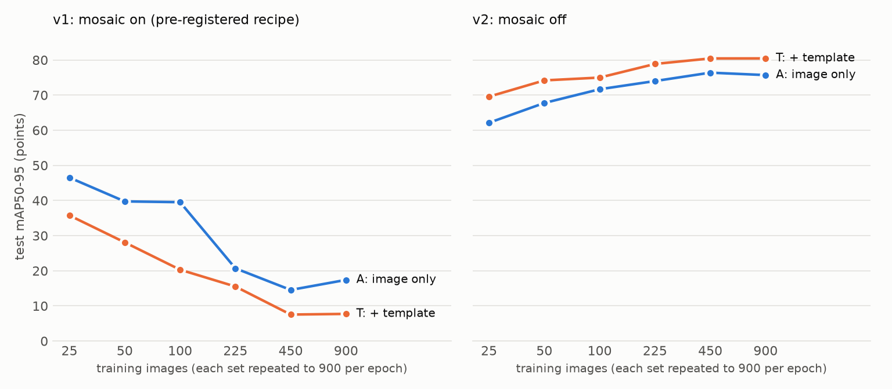

# deeppcb-defects

Finding defects on printed circuit boards with YOLO11s, on the DeepPCB dataset. Every tested board in DeepPCB comes with an aligned, defect-free template of the same board, which is what real inspection lines compare against. This repo checks four things: whether the detector holds up on boards it never trained on, whether feeding it the template helps, where to put the confidence threshold when a missed defect costs far more than a false alarm, and how many labelled boards you actually need.

The five tests were written down in [PLAN.md](PLAN.md) before any model was trained. The first round (v1) used Ultralytics' default augmentation, and its results turned out to be mostly an artefact of one setting, mosaic. So I wrote a declared deviation into PLAN.md (v2: mosaic off, nothing else changed) and reran everything. Both rounds are reported below. v1 isn't hidden or overwritten.

**Short version:** with mosaic off, all five tests pass. Giving the model the template adds +4.75 mAP50-95 points, cuts false alarms from 1.16 to 0.07 per board at the same recall, and T trained on 50 boards scores about what A scores on 900. On our port of the official protocol, T reaches AP 98.9 / F 98.3 (the paper reports 98.6 / 98.2).



*Test mAP50-95 against training set size. With mosaic on (left) the curve gets worse as data grows, which makes no sense for a detector. With mosaic off (right) it rises and flattens, and the template arm sits above the image-only arm at every size. Points are the mean over seeds (two seeds at 25/50/100/900, one at 225/450).*

## Setup

- **Data:** DeepPCB, [github.com/tangsanli5201/DeepPCB](https://github.com/tangsanli5201/DeepPCB) at commit `08e98c4d`, about 130 MB of images. 1,500 pairs of 640x640 binarised greyscale images: a tested image with defects plus its template. Six defect types (open, short, mousebite, spur, copper, pin-hole), 10,013 boxes. The repo's LICENSE file says MIT, but its README says the data is for research use only, so treat everything here as research use.
- **Splits:** the official 1,000 trainval / 500 test. I hold out 100 trainval images as `val` (by hash of the image id), used only to pick thresholds. The other 900 are `train`.
- **Seen vs unseen boards:** the images are crops from 11 source boards. Four of them (groups 12000, 12100, 12300, 90100) never appear in trainval but make up 332 of the 500 test images. That gives a built-in "boards it never saw" test set for free. The other 168 test images are from boards the model trained on.
- **Clean boards:** every tested image has at least one defect, so they can't measure board-level false alarms. The 500 test templates have no defects and serve as the clean set.
- **Arms**, both from COCO-pretrained `yolo11s.pt`, same everything else:
  - **A (image only):** the tested image copied into all 3 channels.
  - **T (template):** 3 channels = tested image, template, and their absolute difference. No change to the network.
- **Training:** 60 epochs, 640 px, batch 16, colour augmentation off (in T the channels mean something), scored at the **last** epoch, no checkpoint picking. About 12 min per run including evaluation on an RTX 5050 laptop GPU.
- **Data curve:** 25 / 50 / 100 / 225 / 450 / 900 training images. Smaller sets are repeated up to 900 entries per epoch, so every run gets the same 3,420 optimiser steps. Otherwise a 25-image run would see 36x fewer updates and the curve would mostly measure training length.
- **Metrics:** COCO mAP50-95 with image-bootstrap 95% CIs, from my `evaluate.py`, which matches pycocotools to 1e-6 (`selftest_eval.py`, 6/6). Comparisons between arms are paired, since A and T see the same test images. I also report the paper's own protocol (IoU > 0.33, AP + F-score). DeepPCB's evaluation script can't run as shipped: it's Python 2, and its parser expects a label format that differs from the repo's own ground-truth zip. `official_eval.py` is a Python 3 port of its logic. I call it "our port", never "the official script".

## v1: the pre-registered recipe (mosaic on)

| Test | What it asks | v1 result |
|---|---|---|
| 1 | Is A worse on unseen boards? | **PASS**, seen − unseen +7.00 [+5.26, +9.03] |
| 2 | Does T beat A by more than the seed spread? | **tie** by the rule, but T is clearly *worse*: −9.68 [−10.36, −8.98] |
| 3 | Fewer false alarms for T at 99% recall? | **FAIL**, and the test couldn't really run: 99% recall was unreachable |
| 4 | Thresholds for miss:false-alarm costs 1 to 200 (descriptive) | distorted by the same recall cap |
| 5 | Does T at 100 images beat A at 100? | **tie** by the rule, T worse (−19.23); the curve falls as data grows |

mAP50-95 was low for both arms (A 16.5 / 18.3, T 8.2 / 7.2), yet at IoU 0.33 both were fine: A AP 95.7 / 94.8, T 96.2 / 96.4 on our port of the official protocol. A detector that finds nearly everything at loose overlap and almost nothing at strict overlap is drawing boxes in the right place at the wrong size.

### What went wrong: mosaic

I checked the boxes directly. The predicted boxes were centred on the ground truth (within 0.3 to 0.6 px) but about 4 px smaller on every side: median 27x25 for A and 26x23 for T against labels of 35x33. The labels have a margin around each defect, and the model learned to draw tight around the defect pixels instead. T was worse because the difference channel shows exactly which pixels changed. Ultralytics' own validator gave the same low numbers, and its data loader reproduces the labels exactly when augmentation is off, so this isn't a coordinate bug on my side.

The suspect was mosaic augmentation (four images tiled into one, then rescaled). Two extra runs with `mosaic=0` and nothing else changed, compared with the seed-0 v1 runs:

| Run | mAP50-95 | median pred box | median best IoU |
|---|---|---|---|
| A, mosaic on | 16.5 | 27x25 | 0.57 |
| A, mosaic off | **75.4** | 34x32 | **0.90** |
| T, mosaic on | 8.2 | 26x23 | 0.52 |
| T, mosaic off | **80.7** | 35x32 | **0.92** |

So mosaic causes the inset. *Why* it does this on DeepPCB I haven't established. One observation: under mosaic plus scale augmentation, the median box the model sees during training shrinks to about 27.5x25, close to what it later predicts. That fits, but I haven't tested it as a cause.

This was found after the v1 results, so it can't quietly replace them. v2 was written into PLAN.md before any v2 run: mosaic off for every run, same tests, same everything else. The two mosaic-off runs above have exactly the v2 settings, so they're reused as the seed-0 900-image v2 runs.

## v2: mosaic off

### Tests 1 and 2: unseen boards and the template (both PASS)

| | seen boards | unseen boards | full test |
|---|---|---|---|
| A seed 0 / 1 | 77.86 / 77.72 | 74.75 / 75.48 | 75.41 / 75.99 |
| T seed 0 / 1 | 80.89 / 80.12 | 80.96 / 80.42 | **80.74 / 80.16** |

- **Test 1 PASS.** A is 2.67 points [+1.08, +4.38] worse on unseen boards. That's much smaller than v1's +7.0, so most of the v1 gap was mosaic too. Caveat: the unseen boards are also *different* boards with their own layouts, not only boards the model didn't train on.
- **Test 2 PASS.** T beats A by **+4.75** [+4.17, +5.26], against a seed spread of 0.58. The gain is bigger on unseen boards (+5.57) than on seen ones (+2.72), and T shows no seen/unseen gap at all. That's what you'd hope from a model that compares against a reference instead of memorising what each board looks like.

### Test 3: false alarms at 99% recall (PASS)

Per run, the threshold is the highest one that gives 99% recall on val (IoU 0.5, defect type ignored, because the board gets pulled either way). Then it's applied to test.

| Run | threshold | test recall | false alarms / board | clean boards flagged |
|---|---|---|---|---|
| A seed 0 | 0.064 | 98.47% | 1.100 | 49.2% |
| A seed 1 | 0.048 | 98.50% | 1.212 | 54.8% |
| T seed 0 | 0.653 | 98.22% | 0.068 | 0.2% |
| T seed 1 | 0.648 | 98.41% | 0.078 | 0.0% |

T has **1.08 fewer false alarms per board** [−1.29, −0.88]. To reach the same recall, A has to drop its threshold to about 0.05 and starts firing on half the clean boards. T can keep its threshold at 0.65. Two things to keep in mind: the val-chosen threshold lands a little short of 99% on test for both arms (98.2 to 98.5%), and the clean-board rate wasn't part of the test because T's clean input (template, template, zero difference) is nearly trivial. With defect type taken into account, T still wins, but one A run couldn't reach 99% class-aware recall on val at any threshold and fell to 0 (9 false alarms per board).

### Test 4: when a miss costs more than a false alarm (descriptive)

Threshold chosen on val to minimise `ratio × misses + false alarms`, then applied to test. Cost per board, seed 0 / seed 1:

| miss : false alarm | A | T |
|---|---|---|
| 1 : 1 | 0.48 / 0.47 | 0.18 / 0.18 |
| 10 : 1 | 1.84 / 1.87 | 0.74 / 0.99 |
| 50 : 1 | 5.90 / 5.70 | 1.94 / 1.73 |
| 200 : 1 | 18.50 / 18.60 | 5.08 / 4.26 |

T costs roughly a quarter to a half of what A costs, at every ratio and on both seeds. At 50:1, for example, T catches 99.5% of defects with 0.33 false alarms per board, while A catches 98.6% with 1.4 to 1.7.

### Test 5: how much labelled data (PASS)

| training images | 25 | 50 | 100 | 225 | 450 | 900 |
|---|---|---|---|---|---|---|
| A | 62.1 | 67.8 | 71.7 | 74.0 | 76.4 | 75.7 |
| T | 69.6 | 74.2 | 75.0 | 78.9 | 80.4 | 80.5 |

At 100 images, T beats A by **+3.33** [+2.46, +4.16], against a seed spread of 0.92. Both arms reach 95% of their own 900-image score at 225 images. T with 50 boards (74.2) is within 1.5 points of A with 900 (75.7). The 225 and 450 points are single seeds.

### Against the paper (our port of the official protocol, IoU > 0.33)

| | AP seed 0 / 1 | F seed 0 / 1 |
|---|---|---|
| A | 97.06 / 96.50 | 95.45 / 96.09 |
| T | **98.94 / 98.98** | **98.38 / 98.34** |
| DeepPCB paper | 98.6 | 98.2 |

F uses a threshold chosen on val, not on test. T matches or slightly beats the paper's numbers on both seeds, with a stock YOLO and the template stacked into its input channels. Keep in mind this is my port of their protocol and two seeds, so read it as "on par", not as a new best.

## What this doesn't show

- **Most DeepPCB defects are drawn on by hand.** The authors added roughly 3 to 12 artificial defects per image, and a model can learn their drawing style. Nothing here says how this would do on a real production line.
- The images come pre-aligned and binarised. Alignment and lighting, two hard parts of real optical inspection, are already solved, and T's advantage depends on that alignment.
- v2 is a post-hoc deviation. The tests and everything except mosaic stayed fixed, but I chose to run v2 after seeing v1. The v1 verdicts are the pre-registered ones.
- Why mosaic causes the box inset is still open.

## Run it

```bash
make download prepare selftest selftest_eval   # data (~220 MB incl. git history) + checks (22/22, 6/6)
make start                                     # v1 queue in the background; run again to resume
JOBS="A900_s1_v2 T900_s1_v2 ..." make start    # v2 runs (full list in PLAN.md)
make status
.venv/bin/python -E -s compare.py [--suffix _v2]                # tests 1, 2, 5
.venv/bin/python -E -s operating.py [--suffix _v2] [--iou 0.33] # tests 3, 4 (IoU 0.33 = post-hoc check)
.venv/bin/python -E -s official_eval.py --run T900_s0_v2        # our port of the paper's protocol
.venv/bin/python -E -s plot_curve.py                            # the figure above
```

`-E` matters if ROS is on your `PYTHONPATH`. The env is Python 3.12, torch 2.11+cu128, ultralytics 8.4.182.

## Files

| File | What it does |
|---|---|
| `prepare.py` | DeepPCB labels → YOLO, hash-based splits, builds the A and T images and the repeated data-curve lists |
| `selftest.py`, `selftest_eval.py` | split/leakage/label/channel checks (22/22); my mAP vs pycocotools (6/6) |
| `train.py`, `queue.sh`, `Makefile` | one run per arm and size, `--recipe v2` for mosaic off, resumable queue |
| `evaluate.py` | COCO mAP with per-image matches saved for bootstrapping, plus seen/unseen subsets |
| `compare.py` | judges tests 1, 2 and 5 |
| `operating.py` | judges test 3, reports test 4 |
| `official_eval.py` | Python 3 port of DeepPCB's evaluation protocol |
| `plot_curve.py` | the figure above |
| `PLAN.md` | pre-registered tests, the v2 deviation and the full running log |

## Licence

The code in this repo is MIT ([LICENSE](LICENSE)). That covers the code only. The DeepPCB data isn't included here and stays under its own terms (research use, see Setup).
